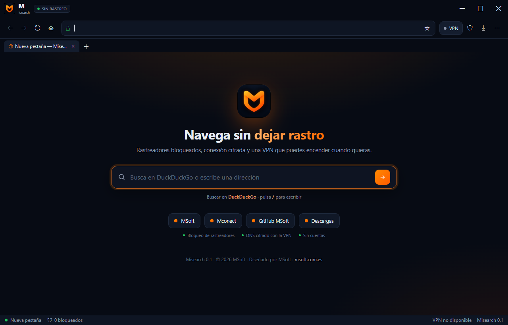

# Misearch

Navegador de escritorio para Windows centrado en privacidad: bloquea rastreadores, impide el acceso a cámara, micrófono y ubicación, y permite encender una VPN (WARP, WireGuard o Clash) solo para el navegador. Sin cuentas, sin sincronización en la nube y sin telemetría.



## Descargas

Última versión: **0.1.2**. Todas las versiones están en [Releases](https://github.com/montyxace-sys/Misearch/releases).

| Formato | Descarga directa |
| --- | --- |
| Portable (ZIP, x64) | [Misearch-0.1.2-win-x64.zip](https://github.com/montyxace-sys/Misearch/releases/download/v0.1.2/Misearch-0.1.2-win-x64.zip) |

Comprueba la integridad de lo descargado con [SHA256SUMS.txt](https://github.com/montyxace-sys/Misearch/releases/download/v0.1.2/SHA256SUMS.txt).

El ZIP contiene `Misearch.exe` (autocontenido, no necesita .NET instalado) y la carpeta `Assets`. Descomprime todo junto y ejecuta `Misearch.exe`. Necesita el runtime de Microsoft Edge WebView2, incluido de serie en Windows 10 y 11 actualizados.

## Funciones

- Pestañas, barra de direcciones, marcadores, historial local y descargas con progreso.
- Buscador configurable: **DuckDuckGo por defecto**, con Google, Bing, Startpage y Brave como alternativas.
- Bloqueo de rastreadores y publicidad con lista integrada y lista propia ampliable.
- Lector de PDF integrado: abre PDF locales con `Ctrl+O` o desde el menú, muestra los PDF web dentro del navegador e imprime con `Ctrl+P`.
- Impresión con previsualización integrada: elige impresora o guarda como PDF sin salir del navegador.
- HTTPS primero: si un sitio no admite HTTPS se avisa y se ofrece la versión no cifrada.
- Modo privado y borrado de datos al cerrar (caché, cookies, historial y almacenamiento).
- Permisos denegados por defecto: cámara, micrófono, ubicación y notificaciones.
- VPN WireGuard o perfil Clash importable, aplicada únicamente al navegador mediante el core [Mihomo](https://github.com/MetaCubeX/mihomo).
- VPN rápida **WARP (Cloudflare)** con un clic: si no hay perfil, se crea uno gratuito automáticamente al activar.
- **Asistente IA opcional**: resume la página abierta, explica el texto seleccionado o lo **traduce al español** con **tu propia clave** de Groq (gratis), OpenRouter u Ollama local. La clave se guarda cifrada con DPAPI y solo se envía el texto cuando pulsas un botón.
- Atajos de teclado: `Ctrl+T`, `Ctrl+W`, `Ctrl+L`, `Ctrl+O`, `Ctrl+P`, `Ctrl+R`, `Ctrl+Shift+Supr`, `Ctrl++`, `Ctrl+-`, `Ctrl+0`, `Alt+←`, `Alt+→`.
- Interfaz oscura con acento naranja y zoom por pestaña.

## Cómo se usa

1. Abre `Misearch.exe`. La primera pestaña muestra el buscador y los accesos rápidos.
2. Escribe una dirección o una búsqueda y pulsa Enter. Las direcciones locales (`localhost`, `192.168.x.x`) se abren por HTTP; el resto, por HTTPS.
3. Para la VPN, abre el panel **VPN** y pulsa **Activar VPN**. Si no has importado un perfil, se crea uno gratuito WARP (Cloudflare) y se descarga el core Mihomo la primera vez. También puedes importar un `.conf` de WireGuard o un YAML de Clash.
4. Los paneles de **Privacidad**, **Historial**, **Marcadores**, **Descargas** y **Ajustes** están en la barra superior y en el menú.

### Asistente IA

La IA está **desactivada por defecto** y no hay ninguna clave de MSoft implicada: cada usuario pone la suya en *Ajustes → Asistente IA*.

- Proveedores: **Groq** (gratis, sin tarjeta), **OpenRouter**, **Ollama** en local (sin clave) o cualquier servidor compatible con OpenAI.
- La clave se cifra con DPAPI (`%AppData%\Misearch\settings.json`) y nunca se muestra completa en pantalla.
- Solo se envía el texto de la página o la selección cuando pulsas un botón: ni historial, ni marcadores, ni direcciones salen del equipo.
- El texto se recorta antes de enviarlo (12 000 caracteres en los resúmenes, 6 000 en traducciones) para no agotar los límites gratuitos.
- Las traducciones usan el modelo más capaz del proveedor (en Groq, `llama-3.3-70b-versatile`) aunque elijas uno pequeño para lo demás: el modelo pequeño se salta líneas y mezcla idiomas en textos largos. Si eliges un modelo a mano, se respeta tu elección.

## Privacidad y seguridad

- El bloqueo de rastreadores se aplica a todas las peticiones de la pestaña y cuenta los bloqueos en la barra de estado.
- Las páginas no pueden abrir ventanas nuevas por su cuenta ni cambiar la dirección sin pasar por el navegador.
- Los permisos sensibles se deniegan sin preguntar; solo se permite leer el portapapeles cuando el usuario lo pide en una página.
- El modo privado viene activado y, al cerrar, se eliminan los datos de navegación del perfil.
- El historial y los marcadores se guardan solo en el equipo (`%AppData%\Misearch`), nunca se envían fuera.
- No hay cuentas, analítica ni servidores de MSoft implicados.

### VPN y kill switch

La VPN se aplica con `--proxy-server` de WebView2 apuntando al core local de Mihomo. Si el core se detiene o el perfil falla, el navegador se queda sin ruta: no hay fuga directa. El core siempre arranca en modo DIRECT cuando está instalado, de modo que activar o desactivar la VPN no deja pestañas sin proxy.

El core Mihomo es software libre GPL-3.0 y **no se redistribuye**: se descarga en tiempo de ejecución desde las releases oficiales de MetaCubeX, verificando el SHA-256 publicado.

## Limitaciones de esta versión (0.1.2)

- Solo Windows 10/11 de 64 bits.
- Una ventana y un perfil: todas las pestañas comparten sesión y proxy.
- Sin extensiones ni sincronización; los PDF se muestran con el visor integrado.
- La VPN cubre solo el tráfico del navegador, no el resto del sistema.
- La VPN usa WARP (Cloudflare) o los perfiles WireGuard y Clash que importes; no incluye servidores propios.
- La lista de bloqueo es estática; no hay suscripciones remotas.

## Compilar

Requisitos: Windows y el SDK de .NET 8.

```
dotnet build App/Misearch.App.csproj -c Release
```

Para generar el ejecutable autocontenido que se publica:

```
dotnet publish App/Misearch.App.csproj -c Release -r win-x64 --self-contained true -p:PublishSingleFile=true -p:IncludeNativeLibrariesForSelfExtract=true -o publish/Misearch
```

## Licencia

MIT. Consulta [LICENSE](LICENSE).
